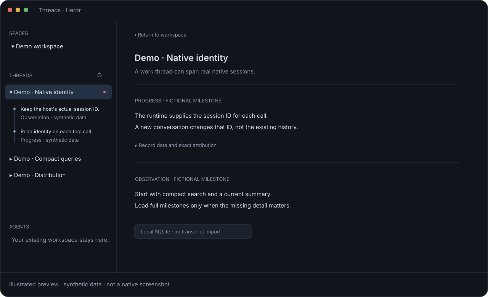

# Threads

Threads adds local work history to an existing Herdr window: compact work rows in the left sidebar, expandable milestones and a central reading view. Work can continue across real agent sessions without importing conversations. Reading and read marks never imply approval.



**Status:** experimental GitHub alpha, not a verified Gallery entry. The illustration uses fictional data; replace it with a reviewed native `preview.png` from an isolated synthetic demo before Gallery publication. No Gallery topic/publication is authorized by this recipe. Four additional host adapters have protocol fixtures, not live compatibility certification; OpenCode V2 discovery remains unverified. See [native integrations](docs/native-integrations.md).

## Requirements and behavior

- Herdr and Node.js 24.15.0+, macOS/Linux with owner-only POSIX storage. No Python, npm runtime packages or separate database server.
- A Node CLI outside the mod provides SQLite reads/writes. **Copying only `mods/threads` is insufficient.** The GPUI mod itself is not a Node process.
- The sidebar orders work by latest activity, uses native position springs and holds open histories while updates arrive. Explicit Update or closing the last visible history releases the hold. The central reader retains its own automatic latest-page updates.
- Agent discovery starts with verified work/current association, then exact references or compact topic search. Full history is read on demand. Milestones, not whole transcripts, are stored.

## Composition

The source mod is `mods/threads/` and declares `place: none`, so it does not automatically dock into another layout. Preserve existing themes, terminal tabs, Spaces/Agents mods, keys and personal layout edits.

The current installer supports an initialized **row-root layout with a left `sidebar` column containing adjacent `spaces` then `agents` blocks**, including the standard nested `sidebar-lists` arrangement. It clones that selected layout and **switches to the clone** before inserting Threads between those sections. It does not replace shipped files. An unsupported layout fails; this is not an arbitrary-layout installer and compatibility with every Gallery layout has not been established.

For a custom layout, keep runtime installation and visual integration deliberate. Do not force this installer past validation, claim foreign files or overwrite a collision. Review [usage](docs/usage.md) before deciding whether the clone/switch behavior is acceptable. A future runtime-only/composable installer is not implied by this package.

The inserted block uses the explicit approved launcher/data paths:

```json
{"id":"threads-sidebar","type":"block","size":{"weight":1},"min":90,"content":{"mod":"threads","props":{"cli":"/absolute/approved/home/.local/bin/threads","dataDir":"/absolute/approved/home/.local/share/threads","channel":"threads-main","role":"section"}}}
```

This is a reference snippet, not permission to edit an active personal layout.

## Install after inspection and consent

1. Inspect this recipe and every runtime/mod/integration file, especially `scripts/install.mjs`, `src/threads`, `integrations/` and `mods/threads`. Explain external process/file access below to the operator.
2. Choose an approved existing HOME and initialized Herdr home outside the repository. Confirm the supported layout structure and the clone/switch side effect. Follow the explicit commands in [usage](docs/usage.md); do not infer the operator's personal paths.
3. Run the read-only doctor against those roots. It does not initialize history, invoke agents or establish live compatibility. Exercise the mod in the approved app; a native check only covers its initial description.
4. Configure optional agents only after separate consent. [Native integration plans](docs/native-integrations.md) emit merge fragments without editing settings, overriding existing hooks or starting a model. Missing/ambiguous native context blocks writes.
5. Verify real behavior with synthetic work. Use the normal host trust/sandbox/approval mechanisms. Never disable them to make a test pass.

## Execution, files and network disclosure

- **Exec:** the mod runs bounded read commands through the configured Node CLI every five seconds. Optional Pi/OpenCode tools invoke the CLI; opt-in hooks run a local Node adapter before direct Threads shell calls. Installation uses the documented Herdr native clone command and changes the shown layout. Doctor probes executable versions.
- **Files:** private SQLite history is pinned under the approved HOME, outside Git. The runtime, discovery entry, shared skill, mod and ownership manifest are installed under that approved home/Herdr root. Optional emitted host settings are only plans until the operator installs them. Full transcripts and credentials are not copied or read.
- **Network:** no network service, telemetry or model call is required by the Threads runtime/installer. Fetching this repository/package is a separate user action. Explicit evidence opening can navigate to an HTTP(S) URL in Dia or reveal a local file; never open evidence automatically. Missing Dia does not authorize another browser.
- **Permissions:** history directories are owner-only 0700 and the database 0600. Unsafe permissions, symlinks and collisions fail rather than being repaired or overwritten. The native host's own sandbox/trust/approval rules remain in force.

## Updates and removal

The installer owns only fingerprinted resources. Unchanged reinstall is a no-op, not an updater; a different/edited install requires inspection and the documented replacement procedure. Preserve a shared layout modified by another mod and keep its ownership warning visible instead of adopting unrelated edits. Do not overwrite edited resources to make doctor green.

Removal preserves database/history, user evidence and edited/foreign files. It never switches layouts or closes terminals. The operator must normally switch away from the integration's layout before removal. See [usage](docs/usage.md) for recovery journals, normal removal and the limits of rollback.

## Distribution and checks

[Distribution](docs/distribution.md) describes the public allowlist and package hashes. The package excludes Git history, research drafts, personal configuration, databases, transcripts and private receipts. Tests use isolated synthetic data; passing fixtures do not certify a real host.

Before a future Gallery publication: validate the chosen host versions, obtain a native synthetic-data screenshot, confirm the public files contain no private information, choose the intended default-branch revision, and get permission for any merge/push/topic changes. The GitHub alpha is tagged independently of the default branch; it does not activate Gallery. The documented topic for this component is `herdr-mod`; discovery/indexing has not been tested for this alpha.

## License

Original Threads code is MIT; see [LICENSE](LICENSE). Host libraries and SDKs are not redistributed and retain their own licenses.
